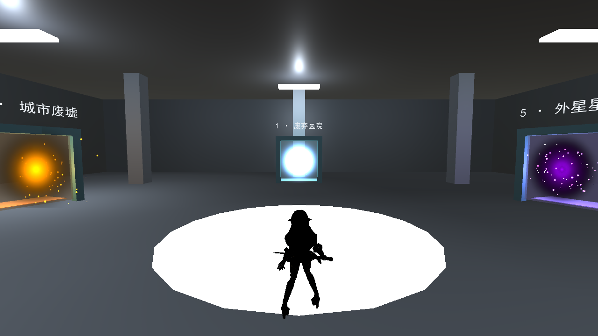
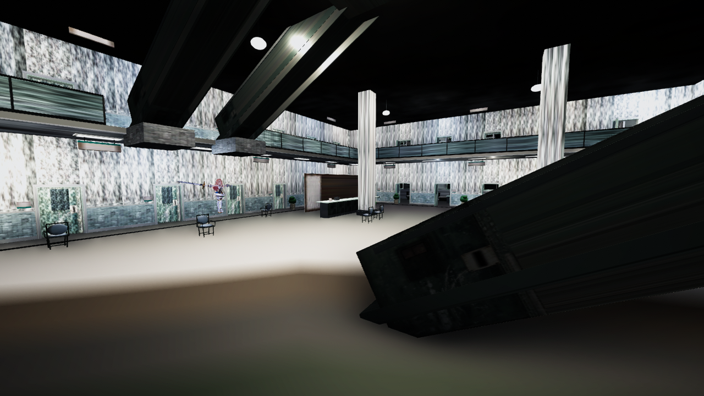
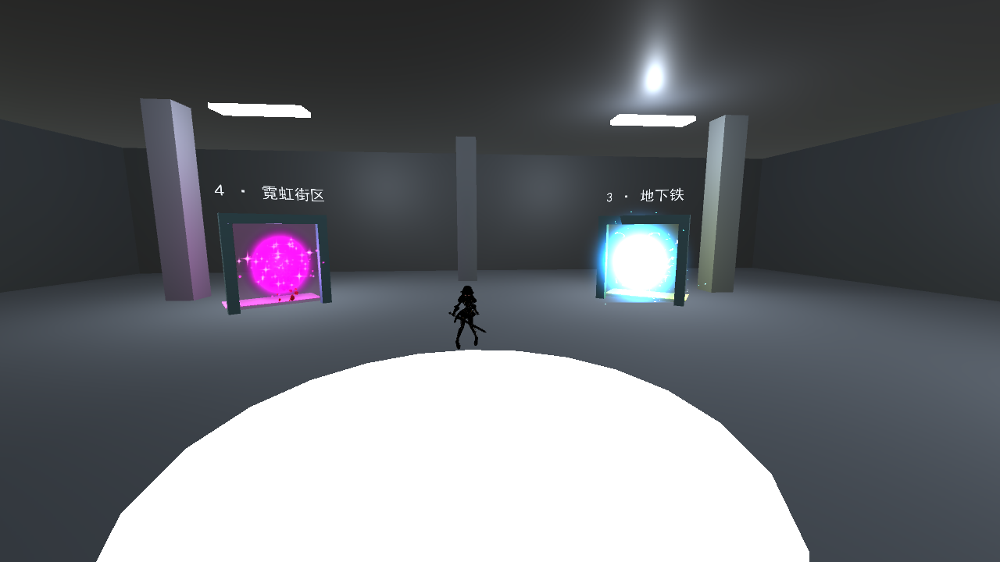
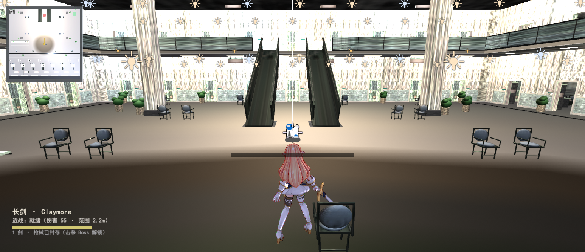

# Medusa Horror · 恐怖动作 Demo

一个基于 Unity 2022.3 的恐怖动作游戏 Demo。近战采用第三人称，切出枪械后采用第一人称。玩家先在医院模拟场完成训练，再进入荒原，开启保护村庄、探索各主题关卡的旅途；中央枢纽「中继站」提供关卡入口。

> 个人作品项目，用于展示客户端系统设计与工程化能力。全部 C# 代码（约 4.6 万行 / 192 个脚本）为独立编写，美术资源来自第三方资源包（见「资源依赖」）。

---

## 玩法结构

```
主菜单 → 中继站（W0_Base）
           ├─ 传送门 1 → 模拟医院 W1   （一楼搜索 → 二楼守卫 → 天台星门 → W2）
           ├─ 传送门 2 → 荒原 W2       （村庄、巡逻敌人、探索与补给）
           ├─ 传送门 3 → 地下铁 W3
           ├─ 传送门 4 → 霓虹街区 W4
           └─ 传送门 5 → 外星星门 W5
                  ↓ 其他关卡依各自目标与 Boss 条件解锁离场门
                  └─ 离场门 / 返回符文 → 回到中继站
```

- 每关出生点旁设「返回符文」，踩上去随时回基地（不需要钥匙）
- 重新进入关卡时钥匙与 Boss 状态自动重置，保证每次挑战都是干净的

## 最新更新（2026-11-27）

- W1 扩展为双层模拟医院与天台：集齐五件训练凭证后开放二楼，击败拟态守卫后通过天台星门前往荒原，衔接守护村庄的剧情。
- 线索取消固定标牌，靠近并用准星对准后才显示名称与 `[E] 拾取`，墙体遮挡时无法交互。
- Tab 面板支持鼠标、分类、翻页、使用和确认丢弃，采用已有素材边框，正文支持滚轮阅读。
- 修复 W4 住宅组件构建后丢失、W3 光照数据引用、旧素材接口和材质计算警告。
- 所有启用关卡的 Windows 64 位清理缓存构建通过：0 错误、0 警告。详细验收边界与素材占位见 [W1 素材替换清单](docs/W1素材替换清单.md)，素材重新导入后的兼容修复见 [构建警告修复](docs/构建警告修复.md)。

---

## 技术实现

### 1. 异步场景加载
`Assets/Scripts/Core/SceneLoader.cs`

- `SceneManager.LoadSceneAsync` + `allowSceneActivation = false` 手动控制激活时机
- 加载界面完全由代码构建（Canvas / 进度条 / 百分比 / 提示文案），不依赖预制体
- 最短展示时长与真实加载进度加权，避免大场景闪一下就过、小场景又卡在 99%
- `RuntimeInitializeOnLoadMethod` 自举，任何场景启动都可用，不需要在场景里手动挂载

### 2. 枢纽式关卡与双向传送
`Assets/Scripts/Gameplay/BasePortal.cs`、`ExitPortal.cs`

- 基地用 5 扇门做关卡选择，距离判定触发（比门洞包围盒更稳，不会因为贴墙误触）
- 关卡侧用「离场门 + 返回符文」两条路径：W1 离场门要求完成凭证与守卫考核，其余关卡按各自目标及钥匙条件解锁；返回符文随时可用
- 传送门状态通过静态字段跨场景传递，并在场景加载时统一重置，避免上一局的钥匙带到新一局

### 3. Boss 状态机与石化机制
`Assets/Scripts/Gameplay/MedusaBoss.cs`、`MedusaGaze.cs`、`PlayerPetrify.cs`

- Boss 三阶段：巡逻 → 追击 → 狂暴（血量低于阈值切换），转向速度、移动速度、攻击间隔随阶段变化
- 石化视线：扇形视锥 + 距离判定 + 视线遮挡检测，玩家暴露在视野中时石化值累积
- 石化值满触发失败结算，拾取「净化结晶」可降低石化值
- Boss 死亡后掉落钥匙并启动顶层传送门，形成完整关卡闭环

### 4. 近战战斗
`Assets/Scripts/Player/MeleeWeapon.cs`、`MeleeSwingBody.cs`、`CameraShake.cs`

- 三段挥砍，每段有独立的伤害窗口、动画时长与位移
- 挥砍期间对扇形范围内的目标做命中判定，命中触发顿帧与镜头震动
- 武器数值集中配置，便于调整手感

### 5. 小地图
`Assets/Scripts/UI/MinimapRig.cs`

- 正交相机渲染到 RenderTexture，固定北向，玩家箭头随朝向旋转
- 按楼层自动切换俯视高度，敌人 / 出口图标跨楼层半透明显示，出界时贴边
- 图标每 0.5 秒重建一次，避免每帧 `FindObjectsOfType`

### 6. 编辑器自动化命令管线
`Assets/Editor/W1Pump.cs`

这是我在这项目里投入最多的工程化部分：

- 通过监听文本文件（`w1cmd.txt`）驱动 Unity 编辑器执行命令，结果写回 `w1res.txt`
- 支持场景加载、相机定点截图、玩家位移、场景搭建、控制台错误抓取、批量校验等 40+ 条命令
- 目的是让「搭建 → 截图 → 视觉核对 → 修错」这个循环可以脚本化、可重复执行，而不是每次手动点编辑器
- 全部关卡的控制台错误/警告清零、场景结构校验、传送链路回归测试，都是通过这套管线自动完成的

### 7. 程序化场景搭建
`Assets/Editor/HospitalBuilder.cs`、`BaseBuilder.cs`、`LevelKit.cs`

- 医院整栋楼（回字形病房、中庭天桥、楼梯、导诊台、候诊椅）由代码生成，不是手摆的
- 基地场景同理：地板墙体立柱、五扇门、灯光、雾效全部程序化
- 好处是布局参数可调、可批量重建，改一个数值整栋楼跟着变

---

## 代码结构

```
Assets/
├── Scripts/
│   ├── Core/          场景加载、全局流程、音频、跌落恢复
│   ├── Gameplay/      Boss、石化、传送门、门交互、掉落
│   ├── Player/        控制器、相机、输入、近战武器
│   ├── UI/            主菜单、Boss 血条、武器 HUD、小地图、中文字体
│   ├── Environment/   墙面变化
│   └── Diagnostics/   性能记录
├── Editor/            编辑器工具与程序化场景生成（40+ 脚本）
└── Scenes/            MainMenu / W0_Base / W1~W5 / W1_Sandbox
```

- C# 脚本：192 个，约 45,580 行
- 场景：8 个（含主菜单与开发沙盒）

---

## 运行说明

仓库**不包含第三方美术资源包**（合计约 18GB）。场景文件里保留了完整结构，但缺少资源时物体会显示为粉红色。

如需完整运行，请自行准备以下资源包并放回 `Assets/` 下对应目录：

| 目录 | 用途 |
|---|---|
| `ApocalypticWasteland/` | 城市废墟关卡（W2） |
| `Space/` | 外星星门关卡（W5） |
| `Dark City 2/` | 地下铁 / 霓虹街区（W3、W4） |
| `HorrorEnvironment_Hospital/` | 医院关卡（W1） |
| `Suriyun/` | 角色模型 |
| `Dynamic Sword Animset/` | 剑击动画 |
| `QFX/` | 传送门与技能特效 |
| `Kevin Iglesias/` | 角色动画 |

**只看代码不需要任何资源**，直接 clone 后用编辑器打开 `Assets/Scripts` 和 `Assets/Editor` 即可阅读。

Unity 版本：**2022.3.11f1c1**，渲染管线：Built-in RP。

---

## 截图

| 中继站 | 医院走廊 |
|---|---|
|  |  |

| 传送门特效 | 小地图 |
|---|---|
|  |  |

---

## 关于 AI 辅助开发

这个项目的开发方式本身就是一次实验：用 AI 编程助手完成大部分代码生成与调试，我负责系统设计、需求拆解、视觉验收和最终把关。

配合上面那套编辑器命令管线，AI 可以直接驱动 Unity 做搭建、截图、跑校验，形成「描述需求 → 生成代码 → 自动验证 → 人工确认」的闭环。这是我认为自己在同类候选人里比较特别的一点。
